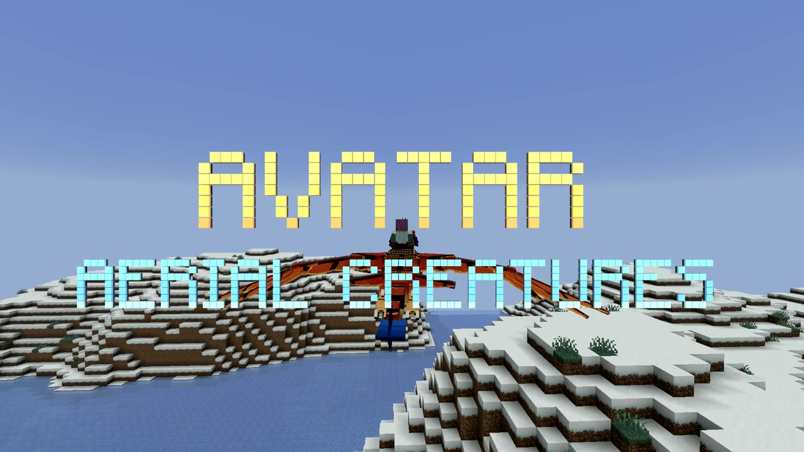
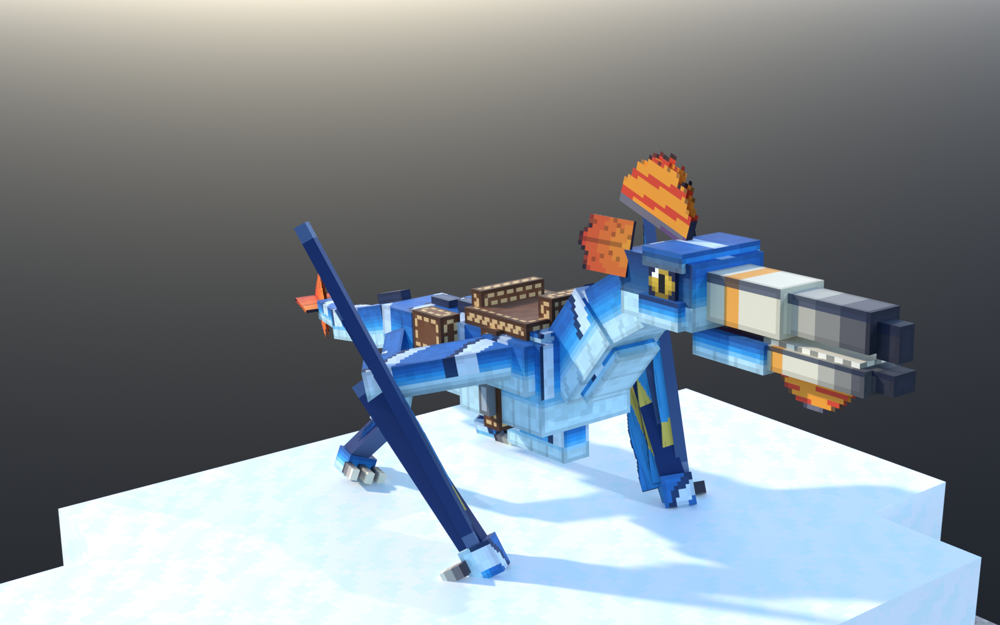
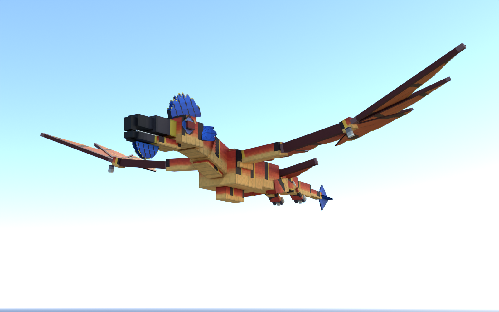
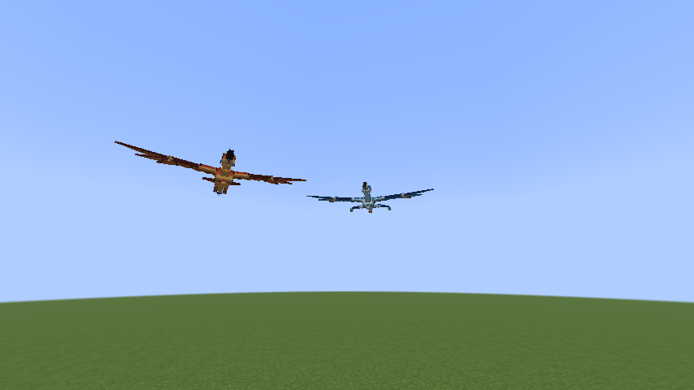
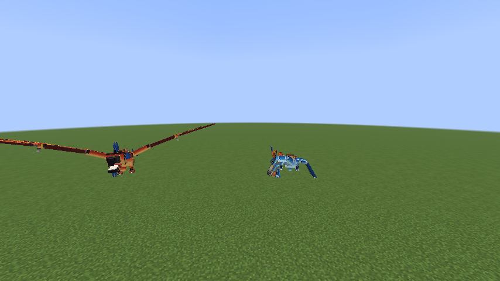
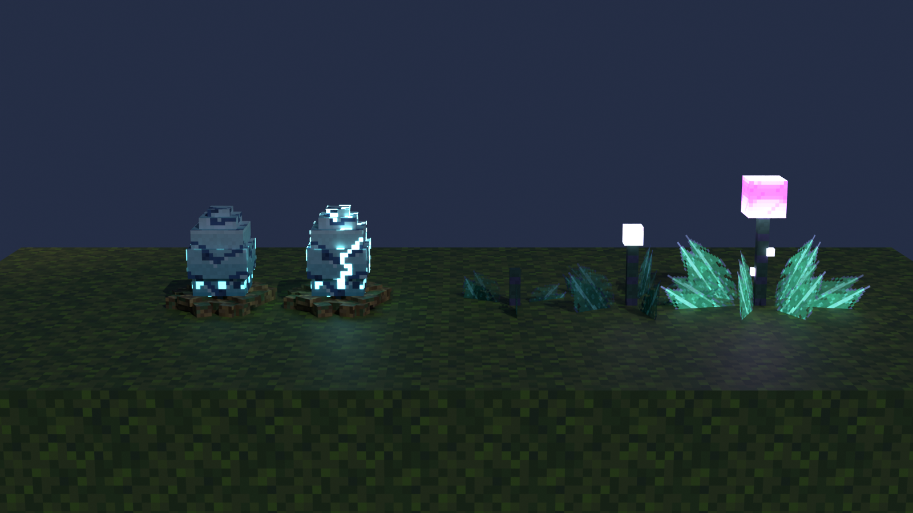

# Avatar Aerial Creatures

**Minecraft Java 26.3 · Fabric mod + Paper plugin**

Tame, ride and raise two flying creatures inspired by Pandora: the agile, four-winged **Mountain Banshee** and the apex **Great Leonopteryx**.

[](https://github.com/Shengboj0324/avatar-aerial-creatures/releases/download/v2.0.0/avatar_aerial_creatures_promo_1080p.mp4)

▶ **Promo and mechanics video (3 min):**
[1080p (267 MB)](https://github.com/Shengboj0324/avatar-aerial-creatures/releases/download/v2.0.0/avatar_aerial_creatures_promo_1080p.mp4) ·
[720p (26 MB)](https://github.com/Shengboj0324/avatar-aerial-creatures/releases/download/v2.0.0/avatar_aerial_creatures_promo_720p.mp4)

## Download

All files are on the [**v2.0.0 release page**](https://github.com/Shengboj0324/avatar-aerial-creatures/releases/tag/v2.0.0).

| Edition | File | Players need |
|---|---|---|
| Fabric mod | [`avatar-aerial-creatures-fabric-2.0.0.jar`](https://github.com/Shengboj0324/avatar-aerial-creatures/releases/download/v2.0.0/avatar-aerial-creatures-fabric-2.0.0.jar) | Fabric Loader ≥ 0.20.1 + Fabric API ≥ 0.165.2 |
| Paper plugin | [`avatar-aerial-creatures-paper-2.0.0.jar`](https://github.com/Shengboj0324/avatar-aerial-creatures/releases/download/v2.0.0/avatar-aerial-creatures-paper-2.0.0.jar) | nothing: the resource pack is sent automatically |

| Mountain Banshee | Great Leonopteryx |
|---|---|
|  |  |

### Install: Fabric
1. Install Fabric Loader 0.20.1+ for Minecraft 26.3 and Fabric API 0.165.2+26.3.
2. Put the Fabric jar in your `mods/` folder (client, and server if you run one).

### Install: Paper
1. Run Paper 26.3 (build 244 or newer) on Java 25.
2. Put the Paper jar in `plugins/` and start the server.
3. The plugin serves its resource pack on port **8163**. Open that port, set `resource-pack.public-host`, or switch `resource-pack.mode` to `url` and host the pack yourself (see `config.yml`).

### Server hosts (BisectHosting, Apex, Shockbyte…)
Shared hosts usually only open your game port, so serve the pack from this release instead of the built-in web server. In `plugins/AvatarAerialCreatures/config.yml`:

```yaml
resource-pack:
  mode: url
  url: "https://github.com/Shengboj0324/avatar-aerial-creatures/releases/download/v2.0.0/avatar_aerial_creatures_pack.zip"
  sha1: "fbee2582f3318d4410cf4c9aa826a2673ae7cd84"
  required: true
```

Then restart the server. Ops can test with `/avatar spawn mountain_banshee`, and `/avatar pack` re-sends the pack to anyone who missed it.

## How it works

**Finding them.** Banshees roost on bare mountain peaks above Y 150, usually in pairs. The Leonopteryx lives alone above Y 120, and it's rare.

**Taming.**
- *Banshee:* sneak up with an empty hand and click. Hand-feeding it fish first builds trust and makes taming easier.
- *Leonopteryx:* wear it down to 40% health, then approach with an empty hand.

**Riding.** Saddle it, then click with an empty hand to mount. These are the Fabric controls; on Paper you steer by looking, jump to climb and sprint for speed.

| Key | Action |
|---|---|
| W | fly forward |
| Mouse | look up to climb, look down to dive |
| Sprint | full speed |
| Z / X | rise / drop |
| Shift | dismount (you're set down safely, even mid-air) |

**Breeding.** Feed an **Incubation Plant** to two tamed adult banshees with the same owner, and they lay an egg. It hatches in 20–40 minutes, twice as fast next to a fully grown plant. Only Silk Touch can move an egg. Hatchlings grow up in about 40 minutes.

**Horn recall.** Sneak-use a *Call* goat horn on your Leonopteryx to pair it. Blowing the horn later summons it, even from another dimension.

**Personality.** Five emotional drives shape how they act. They lean into petting, eat from your hand, yawn, preen and shake off rain. They flutter with joy when you come home, threaten strangers near a wild roost, and sleep at night with their heads tucked in.

| | |
|---|---|
|  |  |
|  | |

### Recipes

| Item | Ingredients |
|---|---|
| Banshee Saddle | leather ×5, iron ingot, string ×2 |
| Leonopteryx Saddle | leather ×5, iron block, iron nugget ×2 |
| Banshee Armor | iron ingot ×6, leather |
| Incubation Plant (×2) | glow berries, warped roots ×3, spore blossom |

## License

All Rights Reserved. See [LICENSE](LICENSE).
